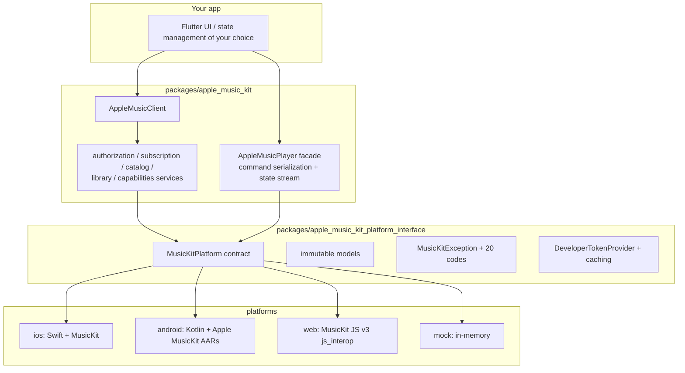

# Architecture

## Layers

## Key decisions

- **Federated plugin**: the app-facing package depends only on the
  platform interface; platform packages register implementations. Adding
  a new platform touches nothing existing.
- **Serialized player commands**: the player facade runs every command
  through a single pending chain, so `setQueue(A); play(); setQueue(B);
  play()` deterministically ends with B playing; a failed command never
  blocks later ones.
- **Seeded, deduplicated state stream**: the facade keeps a permanent
  internal subscription so `currentState` is always fresh, while the
  public `states` broadcast stream replays the latest snapshot and
  suppresses consecutive duplicates.
- **Models map Apple Music API JSON directly**: one parser shared by all
  platforms (platform layers emit API-shaped dictionaries), avoiding three
  duplicate JSON layers.
- **Capability, not exception, for "can"**: structural support, SDK
  presence, authorization, and subscription are reported separately with
  machine-readable reasons.
- **Mock is a first-class platform**: same contract, loudly labeled; UI
  and tests run with zero Apple credentials.

## Platform notes

- **iOS**: `ApplicationMusicPlayer.shared` (app-scoped, never hijacks the
  system Music queue). State observation via Combine
  `objectWillChange` (no async `stateChanges` exists in current MusicKit);
  a 400ms position tick only while playing. Library writes go through
  `MusicDataRequest` (Apple Music API) since the SDK has no structured
  write requests.
- **Android**: `build.gradle` conditionally compiles `src/sdk` only when
  `MUSICKIT_ANDROID_SDK_DIR` contains both Apple AARs; otherwise the stub
  router returns `sdkUnavailable` with setup instructions.
- **Web**: script loaded once per page from Apple's CDN; `musickitloaded`
  awaited with a timeout; events converted via static `dart:js_interop`
  extension types; deep conversion through a reflective helper.
